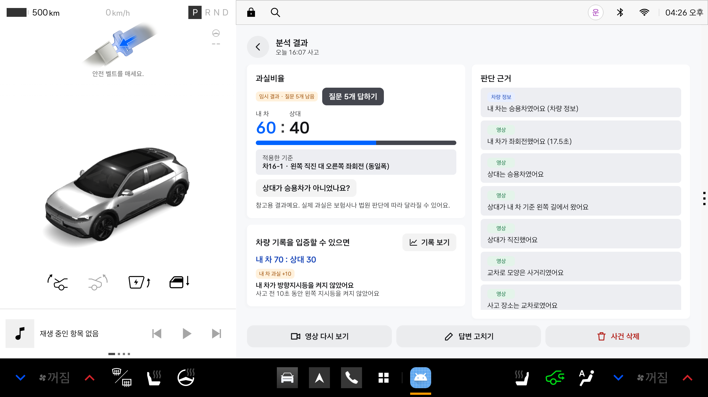
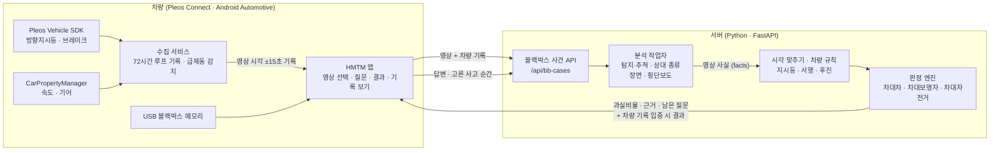
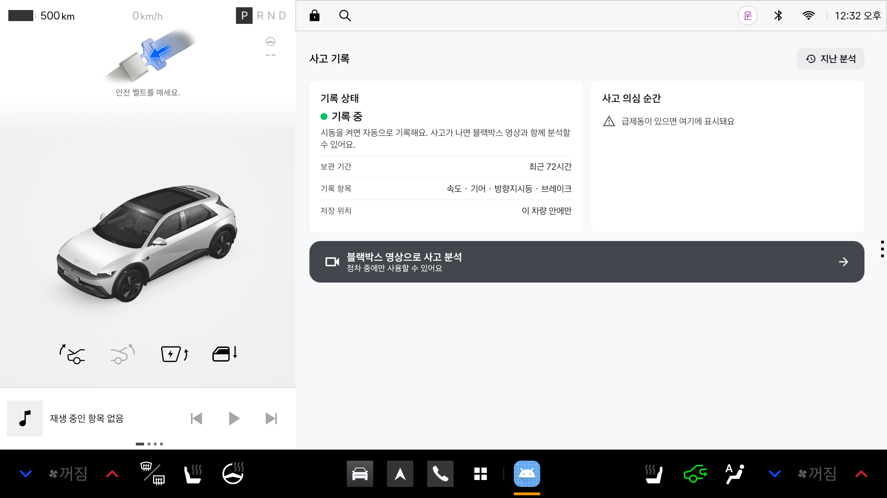
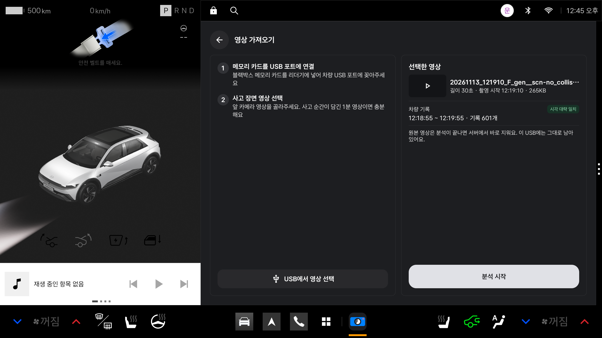
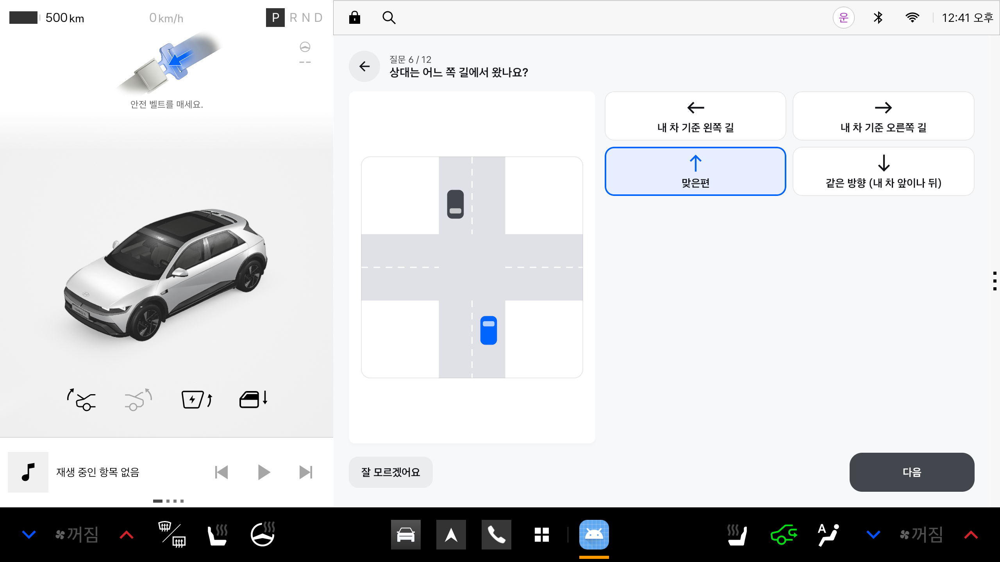
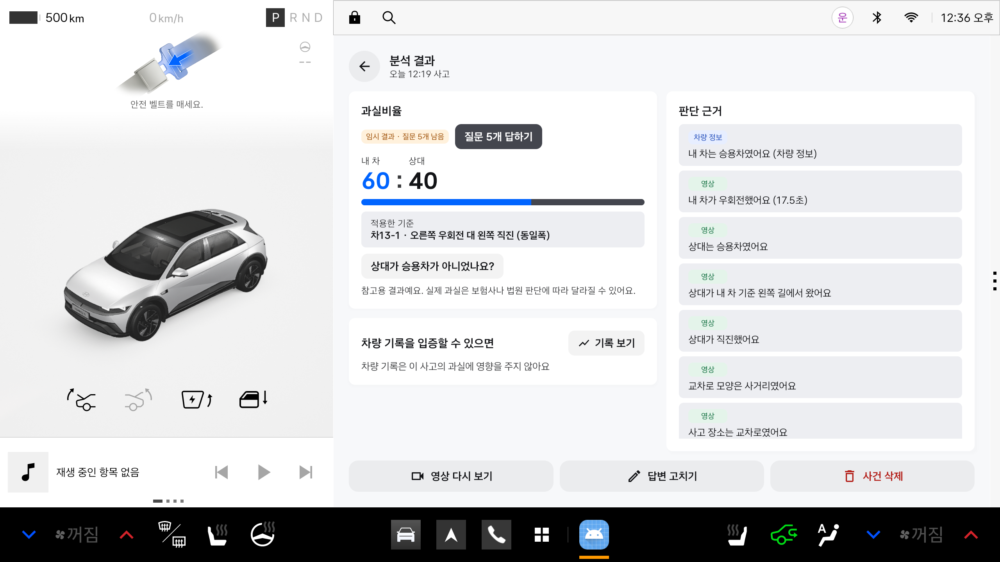
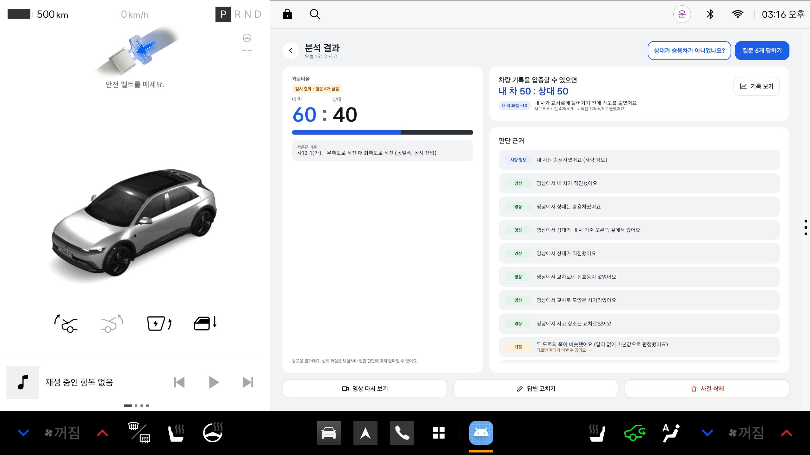
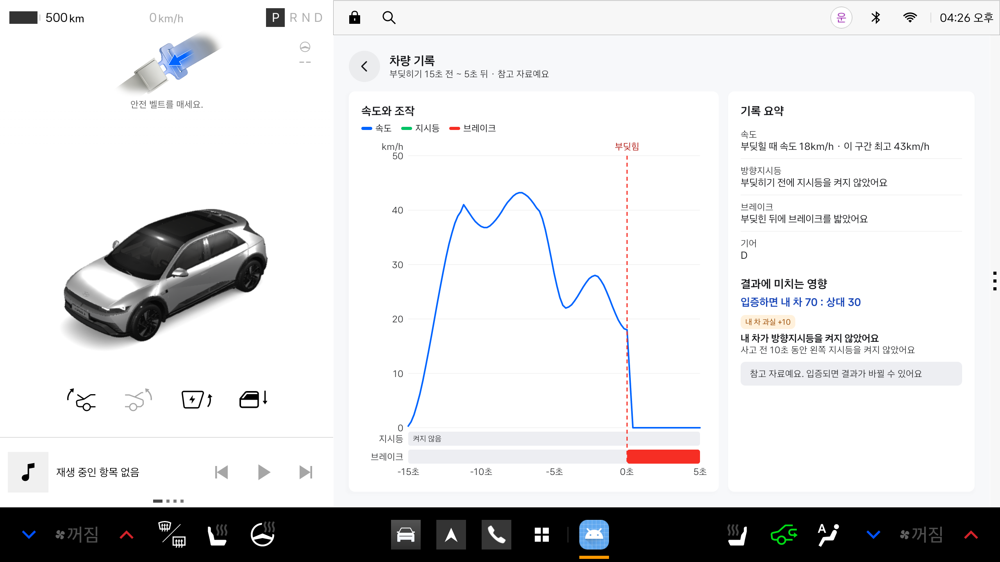
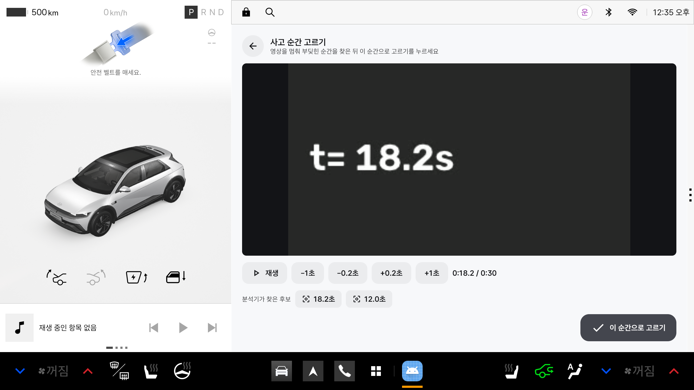
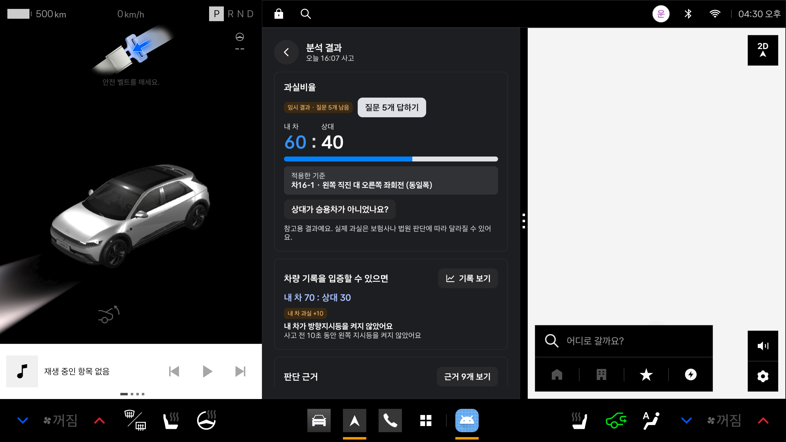

# HMTM — 블랙박스 영상과 차량 기록으로 보는 교통사고 과실비율

> 사고가 나면 차 안에서 바로 **블랙박스 영상**을 올리고 **부족한 것만 답하면**, 「자동차사고 과실비율 인정기준」에 따른 예상 과실비율과 그 근거를 보여 주는 Pleos Connect 차량용 앱.

<p align="center">
  
</p>

## 심사 안내

### 앱 이름·한 줄 소개

- **앱 이름**: HMTM (패키지 `com.example.hmtm`)
- **한 줄 소개**: 블랙박스 영상과 차량 기록(속도·기어·방향지시등·브레이크)으로 교통사고 예상 과실비율과 근거를 보여 주고, 차량 기록을 입증하면 과실이 어떻게 바뀔 수 있는지 알려 주는 Pleos Connect 차량용 앱.

> **앱은 백엔드 서버가 있어야 영상 분석·과실 판정을 할 수 있다.** 서버 없이 앱만 설치하면 **차량 기록 수집**(홈 "기록 중", 급제동 "사고 의심 순간")만 동작한다.
> 심사용으로는 서버를 PC에서 **시나리오 분석기**(모델 가중치 없이 정해 둔 분석 결과를 냄, 아래 "영상 분석기 두 가지")로 띄우면 된다. 에뮬레이터 안의 앱은 `http://10.0.2.2:8000`으로 PC의 서버에 접속한다.

### 실행 방법

Windows PowerShell 기준이며, 명령은 **저장소 폴더**에서 시작한다. 자세한 설명은 [docs/SETUP.md](docs/SETUP.md).
SD 카드 이미지는 에뮬레이터가 켜진 동안 바꿀 수 없어서, **시연 데이터를 먼저 만들고 → 그 이미지를 붙여 에뮬레이터를 켠다.**

**① 백엔드 서버 실행** (PowerShell 창 1, 켜 둔다)

```powershell
cd backend
py -3.12 -m venv .venv
.venv\Scripts\python -m pip install -r requirements.txt
Copy-Item .env.example .env     # MTM_DEV_LOGIN=1(개발용 로그인)이 들어 있다. 분석기는 기본값 = 시나리오 분석기
.venv\Scripts\python -m uvicorn src.server.app:app --host 0.0.0.0 --port 8000 --env-file .env
```

확인: 브라우저에서 `http://localhost:8000/` → `{"service": ...}`

**② 시연 데이터 준비** (PowerShell 창 2, 저장소 폴더) — 블랙박스 SD 카드 이미지(데모 영상 7개)와 영상 시각에 맞춘 차량 기록을 만든다

```powershell
powershell -ExecutionPolicy Bypass -File android\tools\sd.ps1 -Demo -NoEmulator
```

결과: `%USERPROFILE%\hmtm-sd\sdcard.img`(볼륨 이름 `BLACKBOX`), `%USERPROFILE%\hmtm-sd\records`. 처음 한 번은 SD 이미지용 `pyfatfs` 가상환경을 자동으로 만든다.

**③ 에뮬레이터 실행** (SD 카드 이미지를 붙여서. AVD 이름이 다르면 `-avd` 값을 바꾼다)

```powershell
& "$env:LOCALAPPDATA\Android\Sdk\emulator\emulator.exe" -avd Pleos_Connect_v2.1.0 -read-only -sdcard "$env:USERPROFILE\hmtm-sd\sdcard.img" -timezone Asia/Seoul
```

**④ APK 설치와 차량 기록 넣기** (PowerShell 창 2, 에뮬레이터 부팅이 끝난 뒤)

```powershell
$adb = "$env:LOCALAPPDATA\Android\Sdk\platform-tools\adb.exe"
& $adb install -r apk\이견없음_HMTM_release.apk
& $adb shell pm grant --user 10 com.example.hmtm android.car.permission.CAR_SPEED
powershell -ExecutionPolicy Bypass -File android\tools\sd.ps1 -RecordsOnly
& $adb shell am start --user 10 -n com.example.hmtm/.MainActivity
```

설치가 `INSTALL_FAILED_UPDATE_INCOMPATIBLE`로 실패하면 다른 서명(예: 직접 빌드한 debug)의 HMTM이 이미 깔려 있는 것이다. `& $adb uninstall com.example.hmtm` 뒤 다시 설치한다.

Pleos Connect는 운전자 프로필이 사용자 10번이라 `--user 10`을 붙인다. AVD 이름이 다르면 `sd.ps1`에 `-Avd <이름>`을 붙인다.

**⑤ 앱에서 영상 선택**

1. 처음 열면 "사고 기록을 시작할까요?" → **동의하고 시작**
2. 홈 → **블랙박스 영상으로 사고 분석** → **USB에서 영상 선택** → 파일 선택 화면 왼쪽 **`BLACKBOX`** → `Normal` → `Front` → 영상 → **분석 시작**
   (영상 선택 화면에 "시각 대략 일치 · 기록 601개"가 보이면 차량 기록이 붙은 것)
3. 결과 → "질문 N개 답하기" / "차량 기록을 입증할 수 있으면" 카드 → "기록 보기"

| 데모 영상 이름에 붙은 시나리오 | 보이는 것 |
|---|---|
| `right_turn_left_straight` | 차대차 차13-1 "내 차 60 : 상대 40", 질문 |
| `ped_crosswalk_unsignalized` | 차대보행자 보13 "보행자 과실 0%", 가감 요소 질문 |
| `mostly_unknown` | 상대 종류를 추정만 함 → "상대는 무엇이었나요?" |
| `left_turn_motion` | 좌회전 지시등 켬 → "차량 기록은 이 사고의 과실에 영향을 주지 않아요" |
| `left_turn_motion_nosignal` | 지시등 안 켬 → 기록 입증 시 "내 차 70 : 상대 30" (+10) |
| `straight_motion_slowed` | 교차로 앞 서행 → 기록 입증 시 "내 차 50 : 상대 50" (−10) |
| `no_collision_pick` | "사고 순간 확인 필요" → 사고 순간 고르기 → 18.2초 → "내 차 60 : 상대 40" |

### 테스트 환경 및 필요한 설정

| 항목 | 개발·시험한 환경 |
|---|---|
| OS | Windows 11 Home (빌드 26200), Intel Core i7-1165G7, Intel Iris Xe 내장 그래픽 |
| Android Studio | 2026.2.2 (빌드 AI-262.10968.63.2622.16840690) |
| Android Emulator | 35.6.11 |
| JDK (Gradle용) | 21 (JetBrains Runtime 21.0.11). 17도 된다. 25는 Gradle 8.13과 맞지 않는다 |
| Android Gradle Plugin / Gradle | 8.13.2 / 8.13 (Gradle Wrapper 포함) |
| Kotlin / Compose BOM | 2.0.21 / 2024.09.03 |
| Android SDK | Platform 34 (compileSdk 34), Build-Tools 36.0.0 |
| Python (서버) | 3.12 |
| Pleos Vehicle SDK | 2.3.2 (Gradle이 Pleos 저장소 `nexus-playground.pleos.ai`에서 받는다) |

필요한 설정과 주의할 점:

- **에뮬레이터 그래픽**: 내장 그래픽(이 PC는 Iris Xe)에서는 **첫 부팅이 몇 분** 걸릴 수 있다. 같은 PC에서 두 번째부터는 `-read-only`로 약 1분이었다. AVD의 Graphics는 Automatic(`hw.gpu.mode=auto`)으로 두었다.
- **SD 카드**: AVD 설정 `hw.sdCard=yes`를 권장한다. 개발에 쓴 AVD는 `hw.sdCard=no`였지만, 실행 옵션 `-sdcard <이미지>`로 SD 카드가 붙는 것(파일 선택 화면의 `BLACKBOX`)을 확인했다.
- **`-read-only`**: AVD 상태를 바꾸지 않는다. 앱과 기록은 에뮬레이터를 끄면 사라지므로 켤 때마다 ④를 다시 한다.
- **시간대**: `-timezone Asia/Seoul`. 영상 파일 이름의 촬영 시각과 차량 기록 시각을 맞출 때 쓴다.
- **서버 주소**: APK에는 `http://10.0.2.2:8000`(에뮬레이터에서 본 PC)이 들어 있고, 평문 HTTP는 `10.0.2.2`만 허용한다. 다른 주소를 쓰려면 `android/local.properties`에 `backend.url=...`을 넣고 다시 빌드한다.
- **방화벽**: 서버 포트 8000을 Windows 방화벽이 막으면 허용한다.

### 개발에 사용한 Pleos Connect 에뮬레이터 버전과 화면 규격

AVD 설정 파일(`config.ini`)과 켜진 에뮬레이터(`adb shell`)에서 확인한 값이다.

| 항목 | 값 | 확인한 곳 |
|---|---|---|
| AVD 이름 | `Pleos_Connect_v2.1.0` (표시 이름 "Pleos Connect v2.1.0") | `config.ini` |
| 시스템 이미지 | `system-images\android-34\pleos_car_emulator\x86_64` (Automotive, 제공 42dot Inc.), 태그 "Pleos Connect v2.1.0 APIs" | `config.ini`, `source.properties` |
| 빌드 | `RELEASE.release_connect_v2.1.0` (Android 14, API 34, user/test-keys) | `getprop ro.build.display.id` |
| 화면 해상도 | **2560 × 1440** (`hw.lcd.width` 2560, `hw.lcd.height` 1440) | `config.ini`, `adb shell wm size` |
| 화면 밀도 | **160 dpi** (`hw.lcd.density` 160, 1dp = 1px) | `config.ini`, `adb shell wm density` |
| 방향 / RAM / CPU | 가로(landscape) / 4096 MB / 4코어 | `config.ini` |
| **앱 창 (가로, 앱 1개)** | **1682 × 1210 px** (= dp), 화면의 (853, 90)–(2535, 1300). 왼쪽 853px는 드라이빙 뷰, 위 90px는 상태 표시줄, 아래는 GNB | `adb shell dumpsys activity` (앱 실행 중) |
| **앱 창 (1:1 분할, 앱 2개)** | 약 **849 × 1210 px**. 앱 창 영역을 두 앱이 나누고 그 사이에 구분선(약 8px)이 있다 | 분할 창 화면 캡처(`docs/images/pleos_home_light_portrait-split.png`)에서 잰 값 |

앱은 창 크기로 가로 배치(두 열)와 세로 배치(한 열)를 고른다 (`docs/pleos-design-rules.md`).

### APK 파일 위치 또는 GitHub Release 링크

APK는 저장소의 `apk/` 폴더에 있음: [`apk/이견없음_HMTM_release.apk`](apk/이견없음_HMTM_release.apk)

| 항목 | 값 |
|---|---|
| 패키지 이름 | `com.example.hmtm` (앱 이름 HMTM) |
| 빌드 종류 | release (`assembleRelease`, 코드 축소·난독화 끔) |
| 버전 | versionName `0.1.0`, versionCode 1 |
| 최소 / 대상 API | minSdk 28 (Android 9) / targetSdk 34 (Android 14), compileSdk 34 |
| 필요한 기기 | Android Automotive (`android.hardware.type.automotive`) — Pleos Connect 에뮬레이터·차량 |
| 서버 기본 주소 | `http://10.0.2.2:8000` (에뮬레이터에서 본 PC의 백엔드 서버) |
| 서명 | 팀 release 키 (APK Signature Scheme v2). 키 파일·비밀번호는 저장소에 없음 |
| 디버그 가능 | 예 (`debuggable`). 시연용 차량 기록을 `sd.ps1 -RecordsOnly`가 `adb run-as`로 앱 폴더에 넣기 위해서다 |
| 크기 | 62,514,736 바이트 (약 59.6 MB) |
| SHA-256 | `e4865afeb0ff59043a9bde160c3b26fd5427990de24274e7a1e25c875ecb8953` |
| 빌드 | 이 저장소에서 `cd android; .\gradlew assembleRelease` (JDK 21). 서명 값이 없으면 서명 없는 `app-release-unsigned.apk`가 나온다 (docs/SETUP.md 3.1) |

## 해결하려는 문제

- 사고 직후 운전자는 **내 과실이 얼마인지** 모른 채 상대·보험사와 이야기해야 한다. 과실비율 인정기준은 수백 개 도표로 되어 있어 일반 운전자가 직접 찾아 적용하기 어렵다.
- 블랙박스 영상은 있지만, 영상만으로는 **방향지시등을 켰는지, 교차로 앞에서 속도를 줄였는지** 같은 내 차 쪽 사실이 잘 보이지 않는다.
- 이런 사실은 차에 **차량 신호(속도·기어·지시등·브레이크)**로 남는다. HMTM은 블랙박스 영상으로 판정하고, 차량 기록은 **"입증하면 과실이 이렇게 바뀔 수 있다"는 참고 자료**로 함께 보여 준다.

## 핵심 기능

| 기능 | 설명 |
|---|---|
| **시동 시 자동 차량 기록** | 동의하면 시동과 함께 수집 서비스가 켜져 속도·기어·방향지시등·브레이크를 100ms마다 기록한다. **최근 72시간만 차 안에 보관**하고 지난 기록은 저절로 지운다. 급제동(시속 20km 이상에서 1초에 15km/h 넘게 감속)은 홈의 "사고 의심 순간"으로 표시한다 |
| **USB 블랙박스 영상 선택** | 블랙박스 메모리 카드를 차량 USB에 꽂고 시스템 파일 선택 화면에서 앞 카메라 영상을 고른다. 파일 이름에서 촬영 시각을 읽어 **같은 시간대의 차량 기록을 자동으로 찾아 붙인다** ("시각 대략 일치 · 기록 601개") |
| **영상 분석** | 서버의 분석 작업자가 YOLO 기반 탐지·추적으로 사고 순간, 상대 종류(승용차·이륜차·자전거·보행자 등), 상대 진행 방향, 장면(교차로 등), 횡단보도와의 거리를 찾는다 |
| **과실비율 판정** | 판정 엔진이 인정기준의 **차대차·차대보행자·차대자전거 도표**와 가감 요소를 적용해 예상 과실비율·적용 기준(도표 번호)·근거 문장을 낸다 |
| **부족한 정보만 질문** | 영상으로 알 수 없는 것(신호등 유무, 도로 폭, 운전자 요인 등)만 그림이 있는 질문으로 묻는다. 답하면 바로 다시 판정하고, 답에 따라 필요한 질문이 이어진다 |
| **차량 기록은 참고 자료** | 판정은 영상과 사용자 답으로 한 번, 차량 기록을 더해 한 번 더 한다. 결과가 달라지면 "차량 기록을 입증할 수 있으면 내 차 70 : 상대 30 · 내 차가 방향지시등을 켜지 않았어요"처럼 **바뀌는 비율과 이유**를 보여 주고, "기록 보기"에서 사고 전후 속도·지시등·브레이크 그래프를 본다 |
| **사고 순간 고르기** | 분석기가 충돌 순간을 확신하지 못하면 후보 순간을 보여 주고, 사용자가 영상을 보며 고르면 그 순간으로 다시 분석한다 |
| **원본 영상 삭제** | 원본 영상은 분석이 끝나면 서버에서 바로 지운다 (사고 순간 고르기를 기다리는 경우만 최대 7일 보관). USB의 원본은 그대로 남는다 |
| **지난 분석·기록 관리** | 지난 분석 목록, 사건 삭제, 자동 기록 끄기, 모든 기록 삭제(선택: 서버 사건까지), 앱 안에서 사고 3초 전부터 영상 다시 보기 |

## 시스템 구조



- 판정은 두 번 한다: **영상·사용자 답만으로 한 결과**(`result`)와 **차량 기록을 더한 결과**(`result_with_vehicle`). 두 결과가 다를 때 앱이 "입증할 수 있으면" 카드에 차이와 이유를 보여 준다.
- 근거 문장마다 출처(영상 / 차량 기록 / 차량 정보 / 내 답변 / 추정)를 배지로 붙인다.

### 영상 분석기 두 가지

서버 설정 `HMTM_BB_ANALYZER`로 분석기를 고른다. 두 분석기는 같은 출력 형식(bb-0.2)을 내므로 그 뒤의 시각 맞추기·판정·앱 화면은 똑같이 동작한다.

| 분석기 | 설정 | 하는 일 | 쓰는 곳 |
|---|---|---|---|
| **실제 분석기** (YOLO 기반) | `HMTM_BB_ANALYZER=mtm` | 분석 작업자 프로세스가 영상을 탐지·추적해 사고 순간, 상대와 상대 종류, 장면(교차로 형태), 횡단보도를 찾는다 | 실제 블랙박스 영상 분석 |
| **시나리오 분석기** (시험·시연용) | `HMTM_BB_ANALYZER=fake` (기본값) | 정해 둔 시나리오(`backend/src/blackbox/scenarios/`)대로 분석 결과를 낸다. 가중치가 필요 없다 | 자동 시험, 에뮬레이터 시연 |

- **실제 분석기 검증**: 차대차 사고 영상에서 정답과 같은 과실비율(**내 차 30 : 상대 70**)을 냈고, 보행자 사고 영상에서 **보8** 도표로 판정했다.
- 시연 영상의 **차량 기록 비교 장면**(지시등을 켰을 때·안 켰을 때, 교차로 앞 서행)은 차량 기록과 영상 속 내 차 움직임을 맞춘 **시나리오 분석기**로 만들었다.
- 실제 분석기는 **모델 가중치가 필요하며 저장소에 없다** (아래 "데이터·모델 안내"). CPU 서버에서의 분석 속도는 개선 중이다.

## Pleos·차량 API 활용

| 사용한 것 | 어디에 | 코드 |
|---|---|---|
| **Pleos Vehicle SDK 2.3.2** `TurnSignal` | 방향지시등 상태(왼쪽/오른쪽/꺼짐) 기록 → "사고 전 10초 동안 왼쪽 지시등을 켜지 않았어요" | `data/vehicle/VehicleRepository.kt` |
| **Pleos Vehicle SDK 2.3.2** `Brake` | 브레이크 페달 상태 기록 → 기록 보기의 브레이크 띠 | 같음 |
| **CarPropertyManager** `PERF_VEHICLE_SPEED` | 속도 기록, 급제동 감지, 교차로 앞 서행 판단, **주행 중 사용 제한** | `VehicleRepository.kt`, `data/record/HardBrakeDetector.kt` |
| **CarPropertyManager** `GEAR_SELECTION` | 기어(P·R·N·D) 기록 → 후진 판단, 주행 중 판단 | 같음 |
| 포그라운드 서비스 + 부팅 수신 | 시동과 함께 자동 기록 (동의한 경우만) | `service/VehicleCollectorService.kt`, `service/BootReceiver.kt` |
| **Pleos Connect 디자인 가이드** | 색·글자 토큰(라이트·다크), Asta Sans 글꼴, 공통 버튼(100/80/64), 시스템 팝업·토스트, 창 크기에 따른 가로·세로(분할 창) 배치 | `docs/pleos-design-rules.md`, `docs/pleos-tokens.json`, `ui/theme/Theme.kt` |

코드 경로는 `android/app/src/main/java/com/example/hmtm/` 기준.

## 화면

| 홈 (기록 상태·사고 의심 순간) | 영상 가져오기 (USB + 차량 기록 자동 연결) |
|---|---|
|  |  |
| **질문** (영상으로 모르는 것만, 그림과 함께) | **결과** (과실비율·적용 기준·출처 배지가 붙은 근거) |
|  |  |
| **차량 기록 입증 카드** (교차로 앞 서행 → 내 차 과실 −10) | **기록 보기** (사고 전후 속도·지시등·브레이크) |
|  |  |
| **사고 순간 고르기** (분석기가 확신하지 못할 때) | **다크 모드 · 분할 창** |
|  |  |

Pleos Connect 에뮬레이터 화면이다. 영상은 시험용으로 만든 합성 영상(`android/tools/make_test_video.py`)이고, 분석 결과는 시나리오 분석기로 만들었다.

## 설계 원칙

1. **모르면 묻는다.** 판단할 수 없는 값은 추측해서 채우지 않고 비워 둔 뒤 질문으로 남긴다. 근거가 부족하면 "아직 과실비율을 정하지 못했어요"라고 말한다.
2. **사용자 답이 우선한다.** 사용자가 직접 답한 값은 영상 추정값보다 앞선다. 영상과 차량 기록이 서로 다르면 어느 값을 썼는지 알려 준다.
3. **추정값은 미리 고르지 않는다.** 영상으로 짐작한 보기에는 "영상 추정" 배지만 붙이고 사용자가 직접 고르게 한다. "잘 모르겠어요"도 답으로 받는다.
4. **차량 기록은 참고 자료.** 차량 기록은 상대가 확인할 수 없는 내 차의 기록이므로 기본 결과에 바로 넣지 않고 "입증하면 이렇게 바뀔 수 있다"로 따로 보여 준다. 영상과 기록의 시각이 정확히 맞지 않으면 타이밍에 기대는 값은 쓰지 않는다.
5. **운전 중 사용 제한.** 속도 3km/h 이상이거나 D·R 기어면 질문에 답할 수 없고 "정차 후 사용할 수 있어요"를 보여 준다.
6. **개인정보는 최소로.** 차량 기록은 동의한 경우에만, 최근 72시간만 차 안에 둔다. 서버에는 영상 시각 앞뒤 기록만 올리고, 원본 영상은 분석 후 지운다. 언제든 모든 기록을 지울 수 있다.
7. **참고용임을 밝힌다.** 결과마다 "참고용 결과예요. 실제 과실은 보험사나 법원 판단에 따라 달라질 수 있어요."를 보여 준다.

## 구현 상태

| 구분 | 내용 |
|---|---|
| ✅ 구현됨 (앱) | 동의 안내, 자동 차량 기록(72시간·급제동), USB 영상 선택과 차량 기록 자동 연결, 분석 진행, 질문(한 개·여러 개 고르기·묶음·이어지는 질문, 주행 중 제한), 결과·근거·출처 배지, 차량 기록 입증 카드·기록 보기, 사고 순간 고르기, 지난 분석·삭제·기록 설정, 영상 다시 보기, 라이트·다크·분할 창 |
| ✅ 구현됨 (서버) | 블랙박스 사건 API, 분석 작업자, 영상 분석기(탐지·추적·사고 순간·상대 종류·장면·횡단보도), 시각 맞추기, 차량 규칙(지시등·서행·후진 등), 판정 엔진(차대차·차대보행자·차대자전거 도표와 가감 요소), 원본 영상 삭제 |
| ✅ 시험 | backend 608개 통과(결과 고정 시험 포함, 22개는 저장소에 없는 영상·가중치가 필요해 건너뜀), 앱 JVM 단위 시험 88개 통과. 시나리오 분석기로 데모 일곱 사건을 에뮬레이터에서 끝까지 확인 |
| 🔧 개발 중 | CPU 서버에서 실제 분석기의 분석 속도 개선(지금은 영상 하나에 몇 분), 더 많은 실제 블랙박스 영상으로 분석 정확도 평가·기준값 조정, 실차에서 주행 중 제한·급제동 기준 확인 |
| 🗓 계획 | 뒤 카메라 영상, 정식 로그인(카카오·구글), 결과 공유·보험 제출용 요약 |

## 기술 스택

| 영역 | 사용한 것 |
|---|---|
| 앱 | Kotlin 2.0.21, Jetpack Compose (BOM 2024.09.03, Material 3), Android Automotive (compileSdk 34), Pleos Vehicle SDK 2.3.2, OkHttp, Coroutines |
| 서버 | Python 3.12, FastAPI, Uvicorn, SQLite, PyJWT |
| 영상 분석 | Ultralytics YOLOv8 (탐지·추적·장면·횡단보도), OpenCV, PyTorch |
| 판정 | 규칙 기반 판정 엔진 (`backend/judge`, 인정기준 도표를 JSON으로 옮김) |
| 시험 | pytest (결과 고정 시험 포함), JUnit |

## 폴더 구조

```
android/                 Pleos Connect 앱 (Android Studio로 이 폴더를 연다)
  app/src/main/java/com/example/hmtm/
    data/vehicle/        Pleos SDK·CarPropertyManager에서 차량 신호 읽기
    data/record/         72시간 루프 기록, 급제동 감지
    data/bb/             블랙박스 사건 API·결과 모델
    data/video/          USB 영상, 촬영 시각 읽기
    service/             수집 서비스, 부팅 수신
    ui/                  화면 (home, importvideo, analyzing, questions, result, record, player, history)
  tools/                 에뮬레이터 데모 도구 (시험 영상·가상 SD 카드·차량 기록)
backend/                 서버
  src/blackbox/          블랙박스 사건: API, 분석 작업자, 분석기, 시각 맞추기, 차량 기록 효과
  src/vehicle/           차량 기록 규칙 (지시등·서행·후진 등)
  src/server/            FastAPI 앱, 로그인
  src/analyze/           영상 분석 파이프라인 단계
  judge/                 과실비율 판정 엔진과 도표 (rules*.json, modifiers*.json)
  detector/              탐지 모델 학습·데이터 변환 코드
  models.json            필요한 가중치 목록 (sha256·크기)
  tests/                 시험 (golden: 결과 고정 시험)
docs/
  SETUP.md               실행 방법 (자세히)
  design-blackbox.md     블랙박스 사건 설계
  api-spec.md            앱 ↔ 서버 API (차량 기록 사건)
  app-ui.md              앱 화면 설계
  pleos-design-rules.md  Pleos 디자인 가이드 적용 기준
  engine/                영상 분석·판정 엔진 설계
  origin.md              backend 코드 출처
apk/
  이견없음_HMTM_release.apk  심사용 release APK
```

## 직접 빌드·시험하기

심사용 실행 순서는 맨 위 "심사 안내 › 실행 방법". 소스에서 직접 빌드하고 시험하려면 (자세히는 [docs/SETUP.md](docs/SETUP.md)):

```powershell
# 앱 빌드 (JDK 21) → android\app\build\outputs\apk\debug\app-debug.apk
cd android
.\gradlew assembleDebug
.\gradlew testDebugUnitTest            # 앱 단위 시험

# backend 시험 (backend 폴더, 개발용 패키지 설치 뒤)
cd ..\backend
.venv\Scripts\python -m pip install -r requirements-dev.txt
.venv\Scripts\python -m pytest
```

직접 빌드한 APK가 있으면 `sd.ps1 -Demo` 한 번으로 시연 데이터 → 에뮬레이터 실행 → 앱 설치 → 차량 기록 넣기를 모두 한다 (docs/SETUP.md 4절).

## 데이터·모델 안내

- **학습 데이터와 모델 가중치는 이 저장소에 없다.** 탐지 모델은 AI Hub 공개 데이터(교통사고 영상)로 학습했는데, AI Hub 데이터는 이용 약관상 **재배포가 금지**되어 있어 영상·프레임·가중치(`*.pt`)를 올리지 않았다.
- 저장소에는 학습·변환 코드(`backend/detector/`)와 필요한 가중치 목록(`backend/models.json`: 파일 이름·sha256·크기·클래스)만 있다.
- 받는 방법: [AI Hub](https://www.aihub.or.kr)에 가입하고 데이터 이용을 신청 → 승인된 데이터를 `backend/detector/`의 변환 코드로 YOLO 형식으로 바꾸고 `train.py`(또는 `colab_train.ipynb`)로 학습 → 가중치를 `backend/models/`에 두고 `models.json`과 같은지 확인한다.
- **가중치 없이도** 시나리오 분석기(`HMTM_BB_ANALYZER=fake`, 기본값)로 앱·서버·판정 전체 흐름과 데모 일곱 사건을 확인할 수 있다.
- 과실비율 도표는 「자동차사고 과실비율 인정기준」(2023.06.30 개정판)을 판정 엔진용 JSON으로 옮긴 것이다. 결과는 참고용이다.
- `backend/scenes/`, `backend/splits/`에는 영상이 아니라 장면 좌표·파일 이름 목록만 있다.

## 팀 구성과 역할

| 이름 | GitHub | 역할 |
|---|---|---|
| 이성우 | OSOLee | 팀장. Pleos 차량 앱(차량 기록 수집, USB 영상 선택, 질문·결과 화면), 백엔드 서버와 판정 연결, 판정 규칙(차대차·차대보행자·차대자전거), 탐지 모델 학습(객체·횡단보도·교차로 형태) |
| 이상빈 | legna7816 | 블랙박스 영상 분석 엔진(사고 순간·상대 찾기, 상대 종류 판단, 장면·횡단보도 연결), 분석 정확도 평가, 시연 검증 |

## 출처·라이선스

- backend의 영상 분석·판정 코드는 팀의 이전 프로젝트 MTM에서 가져와 블랙박스용으로 고쳤다 (`docs/origin.md`).
- 글꼴 Asta Sans: SIL Open Font License (`android/third_party/asta-sans/OFL.txt`).
